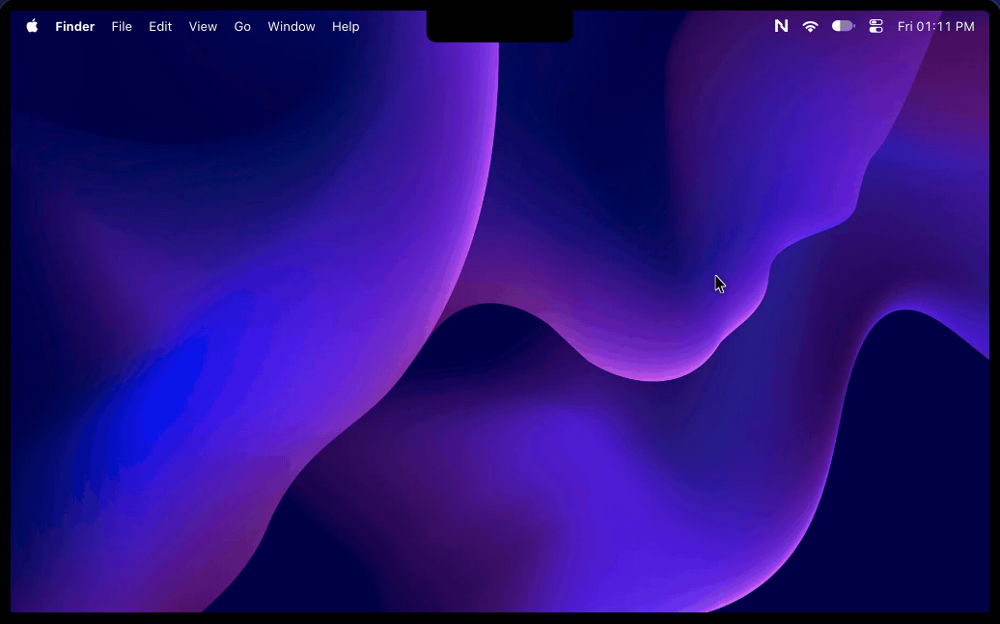

<p align="center">
  
</p>

<h1 align="center">Nightbar</h1>

<p align="center">
  <strong>A black menu bar for macOS.</strong><br>
  White icons on solid black, on any wallpaper. The notch disappears, your wallpaper stays untouched.
</p>

<p align="center">
  <a href="https://nightbar.app">nightbar.app</a> ·
  <a href="#install">Install</a> ·
  <a href="https://github.com/philfreshman/nightbar/releases">Releases</a>
</p>

<p align="center">
  
</p>

## Why Nightbar

- **Readable at a glance.** White icons on solid black, whatever the wallpaper.
- **The notch blends in.** The cut-out disappears into one clean edge.
- **Your wallpaper stays yours.** Never edited or replaced. Turn Nightbar off and it is all back.

## How it works

Nightbar puts a black strip behind the menu bar, just above the wallpaper. macOS sees black behind the bar and draws it black with white icons.

On a light wallpaper, macOS may still tint the bar grey and draw black text. A see-through layer over the menu bar turns the grey black and the text white; clicks pass straight through it. This layer uses private Core Animation parts, so a future macOS may break it; the strip keeps working either way.

Works on every display and in every Space. Full-screen apps are left alone.

## Settings

On or off, launch at login, rounded corners under the bar, quit. That is the whole menu.

## Install

```bash
curl -fsSL https://nightbar.app/install.sh | bash
```

Or [download Nightbar.zip](https://github.com/philfreshman/nightbar/releases/latest/download/Nightbar.zip) and move it to Applications. Nightbar is not notarized, so macOS asks for confirmation the first time you open it.

Needs macOS 14 or later.

## Development

Needs macOS 14+ and Xcode 26+.

```bash
swift test
```

```bash
./scripts/build-app.sh && open build/Nightbar.app
```

Branches, the website and releases are covered in [CONTRIBUTING.md](CONTRIBUTING.md).
